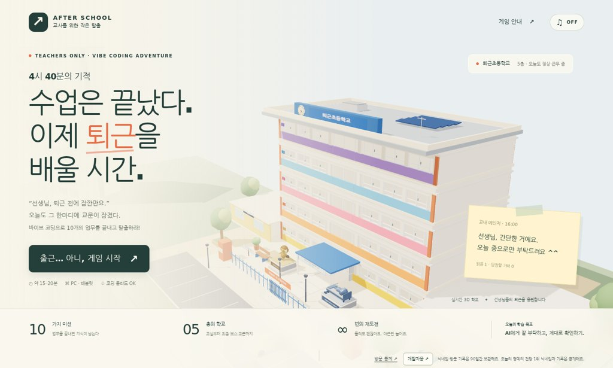
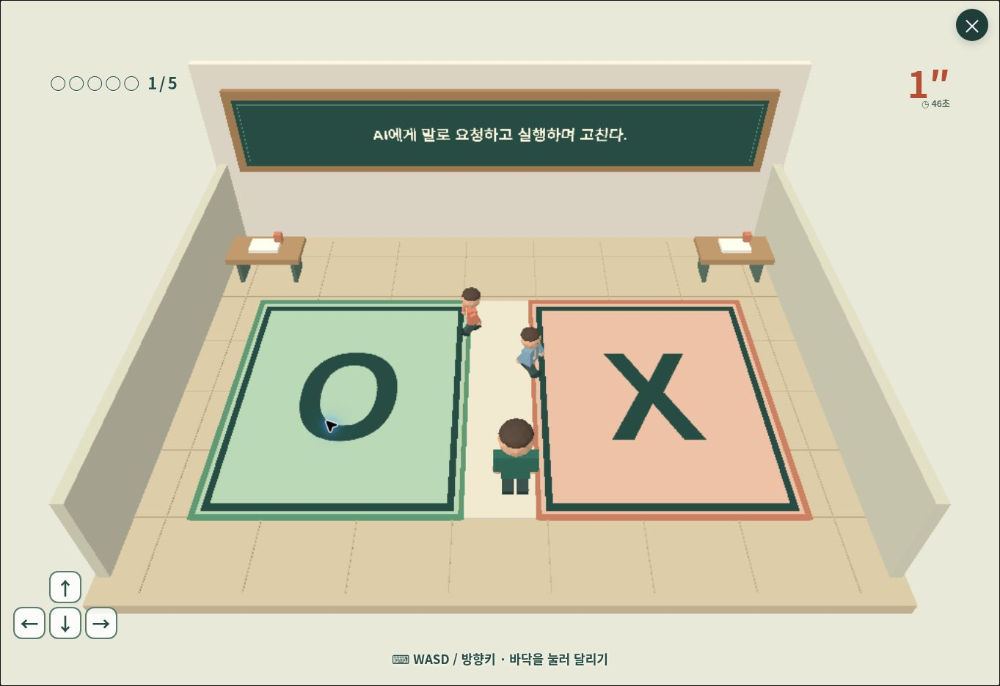

# 4시 40분의 기적 — 바이브 코딩으로 학교 탈출

초등교사 연수용 3D 게임입니다. 퇴근초등학교를 탐색하며 10가지 업무를 해결하고, 바이브 코딩으로 수업자료를 만드는 기본 요령을 익힙니다. 실제 학습자료를 만드는 활동은 게임을 마친 뒤 이어지는 실습입니다.

**[게임 바로 실행하기](https://ddargi0410.github.io/teacher-escape-440/)** · [교사용 전체 대본·정답·해설](./TEACHER-GUIDE.md)

## 이번 업데이트 · 잘 보이는 미션과 쉬어 가는 학교

- **새 게임은 오후 4시, 1층에서 시작합니다.** 현재 시각은 16:00 + 실제로 플레이한 시간 + 벌점입니다. 16:40은 목표 시각이며 업무 10개를 끝내면 더 일찍 퇴근할 수 있습니다. 최대 표시는 22:00입니다.
- **열 미션 모두 시작 안내를 먼저 봅니다.** 초등 5학년 먹이사슬 활동이라는 공통 과제, 지금 할 일, 조작 3단계와 완료 조건을 크게 보여 줍니다. ‘준비됐어요 · 게임 시작’을 눌러야 시작하며 안내·미션 설명·보스 힌트를 읽는 동안 시간이 멈춥니다.
- **급식실:** 내용이 적힌 반찬 카드가 직접 내려옵니다. 카드가 넉넉히 들어가도록 식판과 세 칸을 키웠습니다. 휴대폰에서도 세 칸 모두 낙하 위치에 맞출 수 있으며 아래 1·2·3 버튼으로 칸을 맞출 수도 있습니다.
- **교문:** ‘초등 5학년 먹이사슬 활동 만들기’가 명시됩니다. 막히면 ‘무엇을 쓰지? 힌트 보기’에서 질문 → 문장 틀 → 완성 예시를 확인합니다. 예시를 글에 넣어 고칠 수 있고 글자 수 제한 없이 방패 5개 이상이면 통과합니다.
- **과학실:** 과학 지식 문제가 아닌 **바이브 코딩 습관 9문장**을 판단합니다. 요청 범위·직접 실행·검증·오류 전달·개인정보·공유 확인을 배웁니다.
- **학교:** 테라조 복도, 녹색 하부 벽, 미닫이 교실문·반 번호판·신발장·게시판 등 한국 학교 풍경을 더했습니다. 중앙계단 입구의 벽과 가구를 치워 통로를 넓혔습니다. 지도에서 다른 층의 목적지를 고르면 계단으로 안내하고, 메신저의 ‘업무 위치 보기’는 층에 관계없이 해당 미션 앞으로 즉시 이동합니다.
- **보건실:** 침대 다섯 개 뒤로 꽃·나무 정원이 보입니다. 바로 눕기 / 옆으로 눕기, 숲소리 / 잔잔한 음악 / 목탁 / 무음을 선택합니다. 같은 채널 동료에게도 누운 자세가 보입니다.

## 배움터·보건실과 함께하기

### 처음인 선생님을 위한 배움터

1층 배움터는 **선택형 기초 학습실**입니다. 처음 시작할 때 또는 지도·배움터 버튼에서 들어갈 수 있고, 이미 아는 선생님은 바로 학교로 돌아갈 수 있습니다. 여섯 단계는 짧은 설명과 직접 그린 SVG 삽화, 눌러 보는 예제로 구성되어 있습니다. 학습 완료가 퇴근 조건에 추가되지는 않습니다.

| 단계 | 직접 해 보는 내용 |
| --- | --- |
| 바이브 코딩 | ChatGPT·Claude·Gemini 중 예시 AI를 고르고 말로 요청 → HTML/CSS/JS 예시 코드 생성 → 완성된 식물 퀴즈 눌러 보기 |
| 웹의 세 가지 | HTML 뼈대, CSS 모양과 색, JavaScript 클릭 동작을 같은 앱에서 비교 |
| 좋은 요청 | 역할·대상·목표·조건·출력 다섯 퍼즐로 초4 생태 수업자료 요청 조립 |
| 고쳐 가기 | 숫자가 늘지 않는 버튼을 확인하고, 그 부분만 고친 뒤 다시 실행 |
| 교사의 확인 | 잘못된 과학 설명 확인, 실명 자료를 가상 학생 자료로 변경 |
| API와 배포 | 식물 정보 요청·응답과 앱을 웹 주소로 공유하는 과정을 구별 |

배움터는 브라우저 안의 시연입니다. 실제 AI나 공공데이터 API를 호출하지 않으며 유료 서비스 가입이나 인증키 입력이 필요 없습니다. API는 다른 서비스와 정보를 주고받는 약속이고, 배포는 만든 앱을 주소로 접속할 수 있게 올리는 일이라는 차이부터 배웁니다.

### 아무것도 안 해도 되는 보건실

1층 보건실에 침대 다섯 개가 있습니다. 침대 앞에서 **E**를 누르면 캐릭터가 실제로 눕습니다. 숲소리·잔잔한 음악·목탁·무음과 바로 눕기·옆으로 눕기 중 선택하고, ‘일어나기’나 Esc로 돌아오세요. 소리는 Web Audio로 직접 합성하며 외부 음원을 사용하지 않습니다.

누워 있는 동안 플레이 시간과 독촉 쪽지 타이머가 멈추며, 퇴근 벌점이나 미션은 없습니다. 다른 탭으로 가면 휴식 소리도 멈춥니다. 함께하기에서는 동료가 쉬는 침대가 표시되며 빈 침대를 찾아 사용합니다. 배움터와 보건실 안에는 복도 돌발 캐릭터가 들어오지 않습니다.

### 게임을 시작하면 동료가 바로 보입니다

게임 시작·이어하기를 누르면 **채널 1에 자동 입장**합니다. 방 코드나 입장 버튼을 따로 찾지 않아도 됩니다. 동료에게는 자동으로 만든 익명 별명이 보이며 퇴근 증명서에 쓴 이름은 공유하지 않습니다. 같은 채널·같은 층의 실제 접속자가 캐릭터로 보이고, 정해진 인사 버튼으로 가볍게 교류합니다. **미션·점수·노하우 카드·퇴근 증명서는 각자 진행**합니다.

- 채널은 **1~10**, 채널마다 접속 정원 **30명**, 보건실 침대 **5개**입니다. 처음 들어갈 채널 1이 30명으로 가득 차면 다음 빈 채널을 찾아 입장합니다.
- 화면의 **‘채널 이동’**을 누르면 채널별 접속 인원과 빈 침대 수가 나옵니다. 침대에 누운 상태에서도 버튼을 누를 수 있습니다. 초록 침대 표시가 빈자리입니다.
- 누워서 다른 채널을 선택하면 기존 침대에서 일어나 이동한 뒤, 새 채널의 빈 침대에 다시 눕습니다. 침대 다섯 개가 모두 사용 중이면 채널 선택 화면을 엽니다. 침대가 찼어도 접속 정원에 여유가 있으면 걸어 다닐 수 있습니다.
- 채널 현황은 약 **8초마다** 갱신합니다. 빈 침대 수는 최근 상태이며 예약은 아닙니다. 조회가 실패하거나 정보가 오래되면 ‘확인 중’ 또는 ‘—’로 표시하며 빈 채널로 표시하지 않습니다.
- 캐릭터 위치는 약 1초 간격으로 갱신합니다. 다른 탭을 보거나 창을 닫으면 퇴장을 알리고, 비정상적으로 연결이 끊겨도 약 20초 안에 접속자 목록에서 제외됩니다. 화면으로 돌아오면 다시 연결합니다.
- 채널 화면의 **‘잠깐 혼자 쉬기’**로 혼자 플레이할 수 있고 ‘다시 함께하기’로 돌아옵니다. 중계 서버에 연결되지 않아도 게임과 휴식은 계속할 수 있습니다.

동시 접속은 별도 배포된 [접속 중계 서버](https://teacher-escape-presence.hodumandu.chatgpt.site)를 사용합니다. API 주소는 `https://teacher-escape-presence.hodumandu.chatgpt.site/api/presence`이며 연결 설정은 `presence-config.js`에 있습니다. `GET /api/presence?channels=1`은 공개 채널의 인원·침대 수만 반환하며 이름·위치·인증 정보는 포함하지 않습니다. AI API 키는 필요 없습니다. GitHub Pages 게임 파일과 서버 소스는 별도로 배포합니다. 이전 채널 업데이트 ZIP은 당시 버전의 보관본이며 이번 미니게임 변경을 포함하지 않습니다.

### 복도에서 잠깐 숨통 틔우기

뛰어다니는 두 학생과 과장된 민원 대사를 하는 가상 학부모 NPC 가까이에서 **F**로 말로 진정시키거나 **G**로 만화 같은 ‘뿅!’ 연출을 낼 수 있습니다. 대상은 잠깐 쉬러 사라졌다가 현재 층을 탐색한 시간 기준 20–35초 뒤 다시 나타납니다. 보건실·배움터, 미션·메뉴 중에는 이 동작을 사용하지 않습니다. 실제 다른 접속자의 캐릭터는 대상이 아닙니다.

## 퇴근톡 독촉 쪽지

학교 메신저를 닮은 파란 제목줄의 쪽지 창이 탐색 중 불시에 뜹니다. 미완료 업무 독촉 사이에 커피·복사기·회의 같은 소소한 교직원 잡담도 섞입니다. 이미 끝낸 업무와 아직 잠긴 최종 업무는 새로 독촉하지 않습니다. 실제 인물·대화·로고는 사용하지 않은 게임 연출입니다.

- 튜토리얼 이후 첫 쪽지는 탐색 시간 18–26초, 다음 쪽지는 닫은 뒤 35–60초 사이에 도착합니다. 교감과 마주칠 때도 같은 쪽지를 받을 수 있으며 중복해서 쌓이지 않습니다.
- 이동을 막지 않으며 자동으로 닫히지 않습니다. ‘확인’ 또는 ‘업무 위치 보기’를 눌러 닫습니다. 메뉴나 미션을 여는 동안 잠시 가려져도 돌아오면 읽던 쪽지가 다시 보입니다.
- ‘업무 위치 보기’를 누르면 다른 층이어도 해당 미션 입구로 즉시 이동합니다. 잡담 쪽지는 이동 버튼 없이 확인할 수 있습니다. 확인한 쪽지에는 속마음이 표시되며 실제 메시지를 전송하지 않습니다.
- 화면의 **✉ 보관함**에서 최근 받은 쪽지 60통을 다시 열고 업무 위치로 이동할 수 있습니다. 보관함은 이 브라우저에 저장되어 이어하기에서도 유지되며, 새 게임을 시작하면 초기화됩니다.
- 미니게임·기존 미션·지도·설정·훈화 벌칙 중에는 쪽지와 알림 타이머를 멈춥니다. 다른 탭을 보는 동안에도 정지합니다.
- 쪽지의 알림음은 기존 효과음 ON/OFF 설정을 따릅니다. 문구는 `messenger-data.js`, 발생 규칙은 `messenger-scheduler.js`, 창과 버튼은 `messenger.js`에서 바꿀 수 있습니다.

## 열 가지 업무와 미니게임

모든 미션이 독립적인 `minigames/m01.js`~`m10.js`로 실행됩니다. 기존 완료 기록은 유지하며, 이미 끝낸 미션은 노하우 카드가 열립니다. 새 미니게임을 처음부터 체험하려면 시작 화면에서 새 게임을 선택하세요. 4~10번도 기존 퀴즈 패널 대신 2D 캔버스 또는 실제 3D 방에서 조작합니다. 시작 전 큰 안내 화면과 짧은 플레이 피드백을 사용하고, 자세한 정답·해설은 **열 미션 모두 노하우 카드와 퇴근 증명서 화면**에서 펼쳐 봅니다.

| 번호·장소 | 미니게임과 완료 조건 | 주요 조작 |
| --- | --- | --- |
| 1 · 교실 | **금쪽이 OX 달리기** — 3D O/X 구역에서 5문제. 문항당 5초, 두 학생이 길을 막습니다. | WASD·방향키·화면 이동 버튼 |
| 2 · 연구실 | **믹스커피 카드 캐치** — 역할·대상·목표·조건·출력 카드 5장을 순서대로 받습니다. | 좌우 이동·마우스·터치 |
| 3 · 교무실 | **민원 전화 두더지** — 전화기 6대 중 울리는 전화를 받고 3초 안에 구체적인 요청을 골라 5통 처리합니다. | 전화·선택지 클릭 |
| 4 · 도서관 | **제작 순서 책 꽂기** — 단계 책 7권을 차례로 꽂고 함정 책 1권은 반납합니다. 틀린 책은 튕겨 나옵니다. | WASD·방향키, E 줍기/꽂기. 책·책장·반납함을 눌러 이동 가능 |
| 5 · 컴퓨터실 | **버그 잡기** — 모니터 6대의 벌레 3마리를 잡고 증상·기대·오류 메시지·범위 조각을 맞춥니다. | 드래그 또는 조각→칸 클릭. 숫자 키 지원 |
| 6 · 과학실 | **틀린 코딩 습관 썰기** — AI 사용 습관 9개 중 틀린 것만 자르고 맞는 것은 바구니로 보냅니다. 잘못 판정한 문장은 다시 나옵니다. | 마우스·손가락으로 긋기, X 자르기 / O 담기 |
| 7 · 행정실 | **개인정보 검색대** — 컨베이어 물건 11개를 통과·가상 대체·압수로 분류합니다. | ← 통과 / ↓ 가명 도장 / → 압수, 화면 버튼 |
| 8 · 방송실 | **ON AIR 10초 전** — 현장 입력 소스를 확인하고 글씨·색·소리 버튼을 칩 하나씩으로 고칩니다. 수정 후 10초 안에 저장합니다. | 칩 드래그 또는 칩→입력칸 클릭, 저장 버튼 |
| 9 · 급식실 | **3칸 식판** — 40초간 HTML·CSS·JS를 각 2개 이상 받고, 마지막 20초에 용어 보너스를 3개 이상 맞힙니다. | 좌우·마우스·터치, 1/2/3으로 해당 칸 맞추기 |
| 10 · 교문 | **보스전: 4시 29분의 남자** — 프롬프트로 역할·대상·주제·형식·조건·출력 방패 중 **5개 이상** 켠 뒤 ‘오늘은 퇴근하겠습니다’를 누릅니다. | 글 입력·붙여넣기, 방패 버튼의 짧은 예시 |

4·5·6·7·10번은 시도당 최대 90초, 방송실은 최대 80초, 급식실은 기본 60초입니다. 급식실의 여유 모드에서는 60초 후에도 부족한 항목을 이어서 받습니다. 보너스 시간에는 식판 칸이 용어의 뜻으로 바뀌며 배포·콘솔·할루시네이션·GitHub Pages·링크 공유를 구별합니다. 나가기(× 또는 Esc)는 완료하지 않은 시도를 취소합니다. 보스에게 쓰던 글은 보존됩니다.

7번의 ‘가명 도장’은 **실제 정보를 받기 전 빈 입력칸을 완전히 가상인 예시로 바꾸는 동작**입니다. 실제 명단이나 상담 기록의 이름만 지워도 사용해도 된다는 뜻이 아닙니다. 10번에는 최소·최대 글자 수 제한이 없고, 교장이 다가오는 동안 체크가 켜질 때마다 뒤로 밀려납니다. 시간 초과 후에는 쓴 글 그대로 다시 도전할 수 있습니다.

학교의 NPC는 자기 방에서 천천히 걸으며, 2m 이내에서는 멈추고 플레이어를 바라봅니다. 복도의 두 학생은 부딪히면 1초 비틀거림, 교장은 시야에 들어오면 5초 정지와 게임 속 퇴근 +1분, 교감은 이동을 막지 않는 쪽지를 보냅니다. 교장 시야는 벽·기둥·책장에 가려지며 현재 층의 캐릭터만 움직입니다. 말풍선은 머리 위에서 한 줄씩 2초간 표시되며 누르면 넘깁니다.

교육 문항은 `missions-data.js`에 모아 두었고, 6번은 바이브 코딩 습관 문항으로 개정했습니다. 과거 퀴즈 패널 `missions-ui.js`는 참고·회귀 검사용으로 보존합니다. 현재 짧은 표현과 원문 연결은 `minigames/content.js`, `stage2-content.js`, 실행·종료 관리는 `runner.js`입니다. 모든 게임은 `start({container, data, onWin, onFail})`로 시작하고 `{destroy, pause, resume, hint}`를 반환합니다.

## 실행과 배포

이 저장소의 루트에 게임 실행 파일이 있습니다. Three.js도 `vendor/`에 포함되어 있어 별도의 npm 설치, 빌드, AI 서비스 가입 또는 API 키가 필요하지 않습니다. 게임 실행 자산은 상대 경로로 불러옵니다. 게임 시작 시 자동으로 접속 중계 서버와 통신하며, 채널 화면에서 혼자 플레이하도록 전환할 수 있습니다. 연결이 없어도 기본 게임은 실행됩니다.

GitHub Pages에 올릴 때는 **게임 파일 전체**를 저장소의 루트에 올립니다. `index.html`, CSS, 모든 JavaScript 파일과 `vendor/`를 함께 올리세요. 저장소의 Settings → Pages에서 `Deploy from a branch`, `main`, `/(root)`를 선택합니다. 이번 게임은 기존 학교 탈출 게임과 별도의 새 저장소에서 배포합니다.

완료 후 Pages에서 제공한 주소로 접속합니다. 파일 탐색기에서 `index.html`을 더블클릭하는 방식은 JavaScript 모듈 보안 제한으로 실행되지 않을 수 있습니다. 로컬 확인에는 HTTP 서버가 필요합니다. 최신 Chrome, Edge, 웨일 등 WebGL을 지원하는 브라우저를 사용하세요. WebGL을 사용할 수 없는 PC에서는 같은 Three.js 공간을 Canvas2D로 그리는 호환 3D 모드가 자동으로 작동합니다. 호환 모드에서는 그림자가 생략되고 해상도와 초당 화면 수가 낮아집니다.

문항·정답·해설·NPC 대사 전체는 [교사용 진행 안내서](./TEACHER-GUIDE.md)에서 볼 수 있습니다.

## 조작

| 조작 | 기능 |
| --- | --- |
| W A S D | 이동 |
| 마우스 드래그 | 시선 회전 |
| E | 가까운 업무·NPC·중앙계단·배움터·침대와 상호작용 |
| F / G | 가까운 복도 돌발 NPC 진정시키기 / 만화 효과 |
| H | 힌트 |
| J | 노하우 카드가 든 가방 |
| M | 학교 지도 |
| 채널 이동 | 접속 인원·빈 침대 확인 후 다른 채널 선택. 누워 있을 때도 사용 가능 |
| Esc | 학습·휴식·미션·채널 화면 닫기 또는 일시정지 |
| 화면 조이스틱·버튼 | 태블릿 이동과 상호작용 |

처음에는 조작 튜토리얼을 따라가세요. 1층에서 시작하며 중앙계단을 통해 한 층씩 오갈 수 있습니다. 화면의 위치 안내와 지도를 이용해 업무를 찾으세요.

## 미션과 연수 진행

예상 플레이 시간은 10~20분이며 이동과 읽기 속도에 따라 달라집니다. 1~9번 미션은 원하는 순서로 해결할 수 있습니다. 이 미션들을 모두 마치면 교문 앞의 마지막 업무가 열립니다.

1. 3D OX 달리기: 바이브 코딩과 교사의 역할
2. 믹스커피 카드 캐치: 역할·대상·목표·조건·출력
3. 민원 전화 두더지: 구체적인 프롬프트
4. 제작 순서 책 꽂기: 큰 요청을 작은 단계로 나누기
5. 버그 잡기: 증상·기대 결과·오류·수정 범위 전달
6. 틀린 문장 썰기: AI가 만든 과학 설명 검증
7. 개인정보 검색대: 개인정보와 자료 이용 조건 확인
8. ON AIR 10초 전: 원인을 구분하고 하나씩 수정·저장
9. 3칸 식판: 웹의 구조·모양·동작과 배포 용어
10. 4시 29분의 남자: 프롬프트 방패 5개 이상으로 퇴근

오답은 정답 표시와 짧은 팁을 확인한 뒤 재도전할 수 있습니다. 긴 해설은 가방과 퇴근 증명서에서 읽습니다. 틀릴 때 늘어나는 퇴근 시각은 **게임 속 연출**이며 실제로 기다릴 필요가 없습니다. 게임 속 퇴근은 최대 22:00까지만 늦어집니다. 급식실 시간 제한이 부담스러우면 설정에서 여유 모드를 사용하세요.

마지막 프롬프트 채점은 외부 AI가 아니라 브라우저 안의 규칙과 체크리스트로 이루어집니다. 표현에 따라 제대로 작성한 문장이 누락되거나 부족한 문장이 통과할 수 있으므로 교육적 피드백의 보조 수단으로 사용하세요. 최종 결과물의 과학적 정확성과 수업 적합성은 교사가 확인합니다.

엔딩에서 퇴근 증명서를 PNG 이미지로 저장하고, 자신이 만든 프롬프트를 복사해 이어지는 실습에 사용할 수 있습니다. 증명서는 활동 기념 이미지이며 공식 연수 이수증이 아닙니다.

## 저장과 개인정보

퇴근 증명서 이름, 미션 진행 상황, 설정, 마지막 프롬프트는 현재 기기·브라우저의 localStorage에 저장되며 다른 사람과 공유하지 않습니다. 게임을 시작하면 자동 생성한 익명 별명·채널·캐릭터 위치·층·활동 상태·인사가 접속 중계 서버에 전송됩니다. 채널 화면에서 ‘잠깐 혼자 쉬기’를 선택하면 함께하기 연결을 끊습니다. 채널 목록에는 접속 인원과 사용 중인 침대 수만 공개됩니다. 자유 채팅이나 미션 답안 공유는 없습니다. 접속 확인용 상태만 잠시 유지하며 채팅 기록을 만들지 않습니다. 새 기기, 다른 브라우저, 다른 사이트 주소에는 기록이 자동으로 이어지지 않습니다. 브라우저 데이터 삭제 시 기록이 사라집니다. 저장 기능이 제한된 브라우저에서도 게임은 진행할 수 있지만 이어하기가 작동하지 않을 수 있습니다.

학생의 실제 이름이나 연락처, 상담 내용 등 개인정보를 게임이나 실습 프롬프트에 입력하지 마세요. 닉네임만으로도 플레이할 수 있습니다. 공용 PC에서는 사용을 마친 뒤 새 게임 또는 브라우저 데이터 삭제로 기록을 정리하세요.

## 문구 수정

교육 원문·정답·긴 해설은 `missions-data.js`, 짧은 화면 문구·추가 연습과 원문 연결은 `minigames/content.js`와 `minigames/stage2-content.js`에서 관리합니다. 따옴표, 쉼표, 대괄호 같은 JavaScript 구조는 유지해 주세요. 단순 문구 수정에는 npm이나 빌드가 필요하지 않습니다. 문항 수·제한 시간·채점 규칙을 바꾸면 해당 `m01.js`~`m10.js`, 테스트, 안내 문구도 함께 확인합니다.

| 파일 | 역할 |
| --- | --- |
| `index.html`, `style.css` | 화면 구조와 디자인 |
| `game.js` | 게임 흐름과 3D 루프 |
| `world.js` | 학교·교실·NPC·소품 |
| `player.js` | 이동과 카메라 |
| `missions-data.js` | 교육 내용과 대사 |
| `missions-ui.js` | 원형 퀴즈 패널·채점 보관 및 회귀 검사 |
| `minigames/m01.js`~`minigames/m10.js` | 현재 실행되는 미션별 독립 미니게임 |
| `minigames/content.js`, `minigames/stage2-content.js` | 짧은 문구·원문 연결·추가 연습·카드 해설 |
| `minigames/runner.js`, `minigames/shared.js`, `minigames/minigames.css` | 실행·종료·입력·캔버스 공통 처리 |
| `save.js` | 진행 저장과 불러오기 |
| `audio.js` | Web Audio로 합성한 효과음 |
| `certificate.js` | 퇴근 증명서 이미지와 복사 기능 |
| `learning-room.js`, `learning-room.css` | 선택형 기초 학습과 SVG 삽화 |
| `rest-room.js`, `rest-room.css` | 침대 휴식과 합성 숲소리·목탁 |
| `presence.js`, `presence.css`, `presence-config.js` | 실제 접속자 표시·인사·중계 서버 연결 |
| `channels.js`, `channels-ui.js`, `channels.css` | 자동 채널 입장·인원과 침대 현황·채널 이동 화면 |
| `campus.css` | 배움터·보건실·채널 화면 버튼 |
| `crowd.js` | 복도 캐릭터와 진정시키기·재등장 |
| `vendor/` | 로컬 Three.js와 라이선스 |

사운드는 게임 안에서 직접 합성합니다. 외부 음원이나 3D 모델을 불러오지 않으며, Three.js 배포 시 동봉한 라이선스를 유지하세요.

## 검증

`node --test tests/*.test.mjs`로 검사합니다. 열 미니게임의 정답·오답·완료 한 번만 처리·시간 초과·재도전·일시정지·종료 정리, 원문 보존, 보스 5/6 판정과 입력 저장, 기존 채널·휴식·배움터·복도 기능을 확인합니다. 실제 화면의 입력과 배치는 브라우저에서 추가 확인합니다. 접속 중계 서버의 검사는 별도 서버 프로젝트에서 실행합니다. 게임 실행에는 Node가 필요 없습니다. 최종 검사 수와 실제 기기 확인 범위는 릴리스 안내를 참고하세요.
